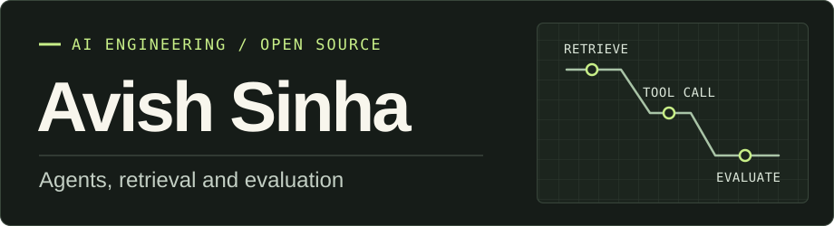

Hey, I’m Avish. I build tools for searching long documents and debugging agents. My favorite part is tracing an answer back to the passage or tool call that shaped it.

VIT Bhopal, CSE ’27 · Open to AI engineering internships  
[LinkedIn](https://www.linkedin.com/in/avish-sinha/) · [Email](mailto:avishsinha10@gmail.com) · [Kaggle](https://www.kaggle.com/avish006)

## Selected work

### [Agent Lenz](https://github.com/avish006/Agent_Eval)

**Can an agent call the right tools and still fail the task?** On seven scripted refund scenarios, tool correctness passed **7/7** and task completion passed **6/7**. I used LangChain traces and DeepEval to see where tool calls, arguments, and plans broke down. [See the evaluation output](https://github.com/avish006/Agent_Eval#empirical-benchmark-results).

### [DocuMind](https://github.com/avish006/Rag-Project)

A PDF reader with chat beside the page. I tested it on books up to 900 pages and used BM25 and FAISS for text retrieval, plus CLIP and on-demand OCR for figures. Repeat uploads reuse the cached index. [Streamlit version](https://github.com/avish006/Streamlit-Rag-Deployment).

### [upstash-haystack](https://github.com/avish006/upstash_haystack)

A Python package that connects Haystack to Upstash Vector. It supports dense and hybrid retrieval and translates nested Haystack filters into Upstash expressions. [PyPI](https://pypi.org/project/upstash-haystack/) · [Haystack listing](https://haystack.deepset.ai/integrations/upstash/) · [Merged listing PR](https://github.com/deepset-ai/haystack-integrations/pull/560)

### More builds

- [**Job Hunt AI Agent**](https://github.com/avish006/job-hunt-agent) derives searches from a résumé, gathers job listings in parallel, and ranks them by skill and text overlap. There’s a React UI and an MCP entry point.
- [**Deep Research Agent**](https://github.com/avish006/deep-research-agent) turns a research question into a sourced report. LangGraph handles planning, collection, and writing, while the UI streams progress.
- **Pathwise** turns a topic into a study roadmap and checks generated content against web sources. I built it at CodeVerse with Abhay Tyagi, Ashish Vishwakarma, and Vaibhav Arora.

## Hackathons & Achievements

| Achievement | Result |
| --- | --- |
| **Kaggle Expert** | Peak rank **1,429 / 60,000+** (Top 3%) · 1 Silver + 5 Bronze medals · 100+ forks · 150+ upvotes |
| **Flipkart Gridlock 2.0** | Ranked **42 / 6,912** — national-level engineering challenge |
| **Shell AI Hackathon** | Ranked **181 / 1,500+** — fuel blend property prediction (ML) |
| **CodeVerse Hackathon** | **Finalist, Top 50 / 300+** teams — built *Pathwise*, an AI-powered EdTech study platform |
| **DSA / Competitive Programming** | **500+ problems** solved across LeetCode, GeeksforGeeks & Codeforces |

Dashboards and credentials

- [Indian Startup Funding](https://github.com/avish006/Startup-Analysis) · [Crypto Trading Analysis](https://github.com/avish006/Crypto-Trading-Data-Analysis) · [Bank Loan Dashboard](https://github.com/avish006/Power-BI-Bank-Loan-Dashboard)

- [OCI Certified Generative AI Professional](https://catalog-education.oracle.com/ords/certview/sharebadge?id=B5989130D2866FAEA5F7AAF2E6B72AACE90BC608CCF3513AFEFF9CC8AF76799A)
- [Deep Learning Specialization](https://www.coursera.org/account/accomplishments/specialization/1DE22K271YAV)

