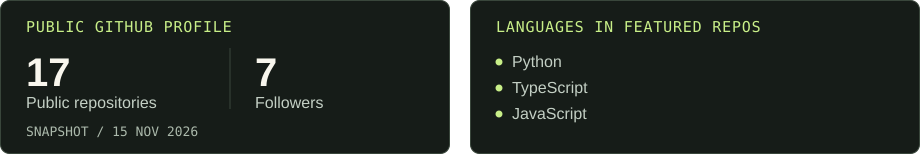

  

  
  
  
  

## About me

I’m Avish, a final-year CSE student at VIT Bhopal, graduating in 2027. I build tools for finding information in long documents and figuring out what went wrong when an agent called a tool.

I published a community integration that adds Upstash Vector to Haystack. My other projects cover evaluating agent traces, searching across job listings, and reading long PDFs with a chat panel beside the page. I’m open to **AI engineering internships**.

## Tech stack

### Languages

### Agents, retrieval, and evaluation

### Backend and deployment

---

## Featured projects

### [Agent Lenz](https://github.com/avish006/Agent_Eval)

> An evaluation harness for tool-calling agents.

- Captures LangChain traces and checks tool selection, arguments, task completion, and answer quality with DeepEval.
- On seven scripted refund scenarios, tool correctness passed **7/7** and task completion passed **6/7**. [Evaluation output](https://github.com/avish006/Agent_Eval#empirical-benchmark-results)

### [DocuMind](https://github.com/avish006/Rag-Project)

> A PDF reader and document chat in the same window.

- Combines BM25 and FAISS for text retrieval, with CLIP and on-demand OCR for figures.
- Tested on books up to **900 pages**. Repeat uploads reuse the cached index. [Streamlit version](https://github.com/avish006/Streamlit-Rag-Deployment)

### [upstash-haystack](https://github.com/avish006/upstash_haystack)

> A Python integration for using Upstash Vector as a Haystack document store.

- Supports dense and hybrid retrieval, batch writes, and nested filter translation.
- [Install from PyPI](https://pypi.org/project/upstash-haystack/) · [Haystack integration directory](https://haystack.deepset.ai/integrations/upstash/) · [Merged listing PR](https://github.com/deepset-ai/haystack-integrations/pull/560)

### More projects

- [**Job Hunt AI Agent**](https://github.com/avish006/job-hunt-agent) derives queries from a résumé, gathers listings in parallel, and ranks them by skill and text overlap. It has a React UI and an MCP entry point.
- [**Deep Research Agent**](https://github.com/avish006/deep-research-agent) uses LangGraph to plan searches, collect sources, and stream a report with citations.
- **Pathwise** is a CodeVerse team project that turns topics into study roadmaps and checks generated content against web sources. Built with Abhay Tyagi, Ashish Vishwakarma, and Vaibhav Arora.

---

## GitHub statistics

  

---

## Repository showcase

<table width="100%">
  <tr>
    <td width="50%" valign="top"><a href="https://github.com/avish006/Agent_Eval"><strong>Agent Lenz</strong></a> Tool call traces and refund agent benchmarks LangChain · DeepEval</td>
    <td width="50%" valign="top"><a href="https://github.com/avish006/Rag-Project"><strong>DocuMind</strong></a> Read and query long PDFs side by side Flask · FAISS</td>
  </tr>
  <tr>
    <td width="50%" valign="top"><a href="https://github.com/avish006/upstash_haystack"><strong>upstash-haystack</strong></a> Upstash Vector for Haystack pipelines Python · Haystack</td>
    <td width="50%" valign="top"><a href="https://github.com/avish006/job-hunt-agent"><strong>Job Hunt AI Agent</strong></a> Resume-aware job search and ranking FastAPI · React · MCP</td>
  </tr>
</table>

## Hackathons & Achievements

| Achievement | Result |
| --- | --- |
| **Kaggle Expert** | Peak rank **1,429 / 60,000+** (Top 3%) · 1 Silver + 5 Bronze medals · 100+ forks · 150+ upvotes |
| **Flipkart Gridlock 2.0** | Ranked **42 / 6,912** — national-level engineering challenge |
| **Shell AI Hackathon** | Ranked **181 / 1,500+** — fuel blend property prediction (ML) |
| **CodeVerse Hackathon** | **Finalist, Top 50 / 300+** teams — built *Pathwise*, an AI-powered EdTech study platform |
| **DSA / Competitive Programming** | **500+ problems** solved across LeetCode, GeeksforGeeks & Codeforces |

Dashboards and credentials

- [Indian Startup Funding](https://github.com/avish006/Startup-Analysis) · [Crypto Trading Analysis](https://github.com/avish006/Crypto-Trading-Data-Analysis) · [Bank Loan Dashboard](https://github.com/avish006/Power-BI-Bank-Loan-Dashboard)

- [OCI Certified Generative AI Professional](https://catalog-education.oracle.com/ords/certview/sharebadge?id=B5989130D2866FAEA5F7AAF2E6B72AACE90BC608CCF3513AFEFF9CC8AF76799A)
- [Deep Learning Specialization](https://www.coursera.org/account/accomplishments/specialization/1DE22K271YAV)

---

## Let’s connect

I’m happy to talk about document retrieval, agent evaluation, or internship opportunities. [LinkedIn](https://www.linkedin.com/in/avish-sinha/) · [Email](mailto:avishsinha10@gmail.com)
